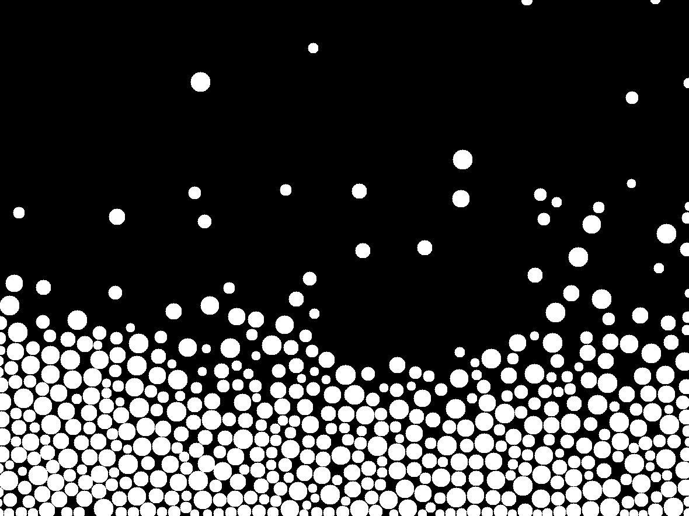

[Home](../../../../index.md) / [Smaller Projects](../index.md) /

# SDL Rendering

This code renders several circles using the SDL graphics library.



## Circle texture
To avoid pixel rendering, the code can render a texture in its place.

```cpp
static SDL_Texture* make_circle_texture(SDL_Renderer* renderer, int radius){
    int diameter = radius * 2;

    SDL_Surface* surf = SDL_CreateSurface(diameter, diameter, SDL_PIXELFORMAT_RGBA8888);
    if (!surf) return NULL;

    Uint32* pixels = (Uint32*)surf->pixels;
    Uint32  white = SDL_MapSurfaceRGBA(surf, 255, 255, 255, 255);

    for (int y = 0; y < diameter; y++) {
        for (int x = 0; x < diameter; x++) {
            int dx = x - radius;
            int dy = y - radius;
            if (dx*dx + dy*dy <= radius*radius) {
                pixels[y * surf->pitch / 4 + x] = white;
            }
        }
    }
    SDL_Texture* tex = SDL_CreateTextureFromSurface(renderer, surf);
    SDL_DestroySurface(surf);
    return tex;
}
```

### Setup
At the beginning of a program using the rendering engine, it must setup the window and renderer:
```cpp
static SDL_Texture* circle_tex[MAX_RADIUS + 1];
static SDL_Window* window;
static SDL_Renderer* renderer;

bool open_window(){
    if(!SDL_Init(SDL_INIT_VIDEO)){
        printf("SDL_Init failed: %s\n", SDL_GetError());
        return false;
    }

    window = SDL_CreateWindow(
        "Physics",
        1200, 900,
        SDL_WINDOW_RESIZABLE
    );

    if(!window){
        printf("SDL_CreateWindow failed: %s\n", SDL_GetError());
        SDL_Quit();
        return false;
    }

    renderer = SDL_CreateRenderer(window, NULL);
    if(!renderer){
        printf("SDL_CreateRenderer failed: %s\n", SDL_GetError());
        SDL_DestroyWindow(window);
        SDL_Quit();
        return false;
    }
    for (int r = 1; r <= MAX_RADIUS; r++) {
        circle_tex[r] = make_circle_texture(renderer, r);
        if (!circle_tex[r]) {
            printf("Failed to create circle texture for radius %d\n", r);
        }
    }
    return true;
}
```

### Rendering the circle
The texture can be placed on the window at specific coordinates using a rectangle and calling SDL_RenderTexture:

```cpp
void render_particle(int x, int y, int r){
    SDL_FRect dst = {
        x - r,
        y - r,
        r * 2,
        r * 2
    };
    SDL_RenderTexture(renderer, circle_tex[r], NULL, &dst);
}

void update_display(){
    SDL_RenderPresent(renderer);
}
```

### Cleanup
At the end of the code, the window must be cleaned up with the following code. The should quit function can be used to exit out of an endless loop when the window is manually closed:

```cpp
void close_window(){
    SDL_DestroyRenderer(renderer);
    SDL_DestroyWindow(window);
    SDL_Quit();
}

void close_window(){
    SDL_DestroyRenderer(renderer);
    SDL_DestroyWindow(window);
    SDL_Quit();
}
```