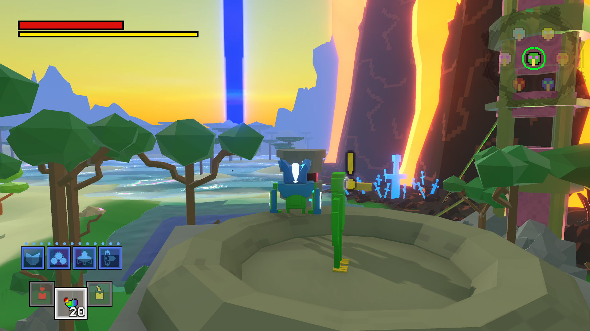
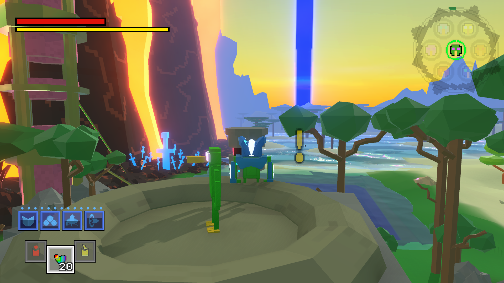

[Home](../../../../index.md) / [Smaller Projects](../index.md) /

# Mirror Mode
In many racing games, there is a mirror mode version of every race track, flipping the X coordinates (left turns become right turns) adding some extra variety to the tracks for very little developer effort. Some games flip the entire scene geometry for better control (such as not flipping text). However, this is less maintainable as every change in one track must be propagated to the mirror version. On large scenes, flipping the geometry can also be costly. So, the cheapest and most maintainable solution is to simply flip the rendered screen using a fullscreen shader. The shader ignores UI elements.

<a href="/assets/files/shaders/mirror.shadergraph" class="yellow-link" download>
    Download mirror.shadergraph
</a>

**Before:**

**After (with mirror shader):**

The fullscreen shader must be placed on the Universal Render Pipeline asset settings as a Full Screen Pass Renderer Feature.

This fullscreen shader in Unity URP ShaderGraph is created by flipping a UV's x coordinate by setting x = 1 - x. This flipped UV is input into URP's BlitSource buffer. Unlike of texture sampling types (scene colour, camera render textures) blitsource renders after transparent objects, post processing effects, and particles, leaving the rendered scene exactly the same as before applying the shader. Scene colour is a worse alternative, where all transparent materials (most notably water) are absent from the final render.

Since only the screen is flipped while the world remains in place, the camera and movement controls must also be flipped by multiplying the x inputs by -1.