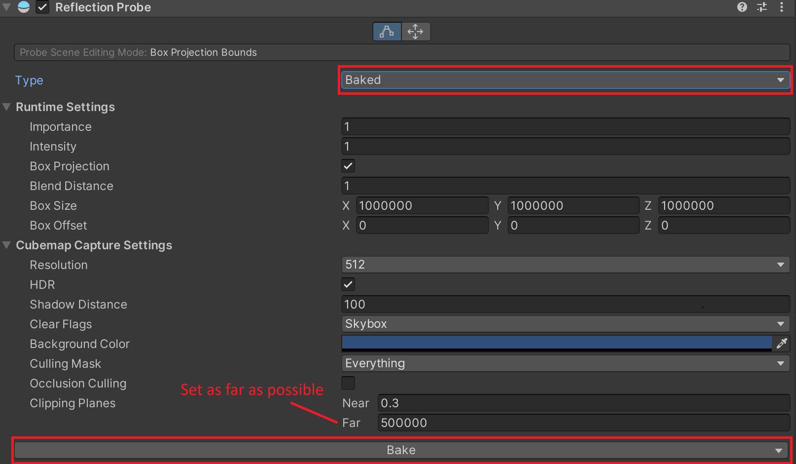
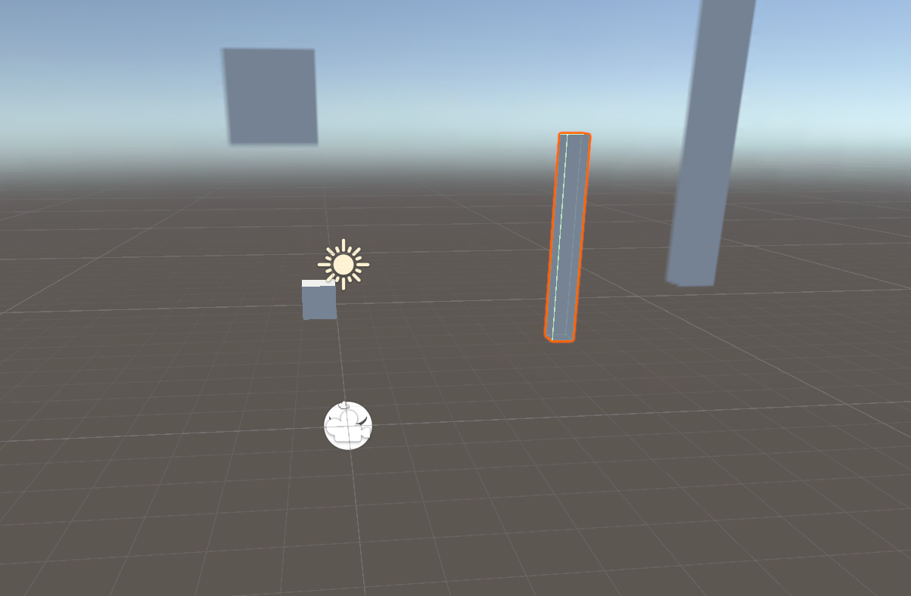

[Home](../../../../index.md) / [Tutorials](../index.md) /

## Overview
When making complex backgrounds, the far plane can be rendered inside the skybox, saving on rendering costs. Distant backgrounds are commonly rendered as 2D textures; however, these can be difficult and time consuming to create. Instead, the background can be created with actual geometry, and later encoded into a cube map.

## Prerequisites

You must already have a skybox, and required geometry. Only include distant geometry, as it can only be encoded from one specific coordinate in space. Encoding closer geometry can break depth perception, breaking immersion. This tutorial has been tested on both Unity 5 and 6.

## Method 1 - Reflection Probe Cube Map
The simplest method is with a cube map, generated via the reflection probe. 
Simply place a reflection probe where you want the skybox origin, set the far clipping plane to reach the furthest geometry, and bake the probe. The cubemap is output into the directory labelled after the scene (usually found next to where you have the scene file stored). 

Mark all desired geometry **reflection probe static**, otherwise it does not appear in the bake.



Make sure to duplicate the cubemap, as the original will be overridden in subsequent bakes. This cubemap can be input directly into a cubemap skybox shader.



The downsides of this method are:
-	The output can become blurry depending on the resolution.
-	The resulting skybox is static (so no clouds, stars, day-night cycle etc).
-	Can take a while to bake.
-	Inconsistent handling of transparent shaders.

## Method 2 - 360 Panoramic Video

The second method solves most of the downsides to method 1, at the cost of higher complexity. This method involves creating a 360-degree video, and rendering it in a panoramic skybox. With a video, it can be used for dynamic skyboxes, such as recording a full day-night cycle.

The easiest way to record the video is through the *Recorder* package. Install the package using the *Package Manager*, searching *Recorder* in the *Unity Registry*.

Open the recorder menu from **Window -> General -> Recorder -> Recorder Window**

With the recorder window open, follow these steps:
1.	Add Recorder – Movie
2.	In the Movie, under *Input* set the *Source* to 360
3.	Set the camera. Move your target camera to the desired origin point, and ensure the camera has no rotation. If the output is rotated, this is due to the camera rotation.
4.	Set the output dimensions to be equirectangular (width is double height, such as 4096, 2048).
5.	Disable *Record in Stereo*. We only want one video channel.
6.	Set the output directory to *Assets Folder*. The video must be in assets to build with the game.
7.	Set the recording mode. Time interval can give the most consistent results.
8.	Start recording.
9.	Rename the output and group it with your skybox.

The video recording can be mapped to a panoramic skybox using a render texture. Create a new render texture next to the video, and match its dimensions to the recording. Set the skybox’s target texture to this render texture.

In your scene, create an empty gameobject and add a Video Player component. Set the video clip to the 360 video; *Render Mode* to *Render Texture*; *Target Texture* to your created render texture; and *Audio Output Mode* to *None*. For the video to play continuously, enable looping. The skybox will remain grey until the video player runs.

While the video player is runtime only, it can be previewed in the editor with this script, placed inside the Assets/Editor folder. It adds stop and play buttons to the Video Player’s inspector menu. However, it reveals hidden fields, so only use it after setting up the component.


```csharp
using UnityEditor;
using UnityEngine;
using UnityEngine.Video;

[CustomEditor(typeof(VideoPlayer))]
public class VideoPlayerEditor : Editor{
    public override void OnInspectorGUI(){
        DrawDefaultInspector();
        VideoPlayer vp = (VideoPlayer)target;

        if(GUILayout.Button("Play")){
            vp.Play();
        }
        if(GUILayout.Button("Stop")){
            vp.Stop();
        }
    }
}
```