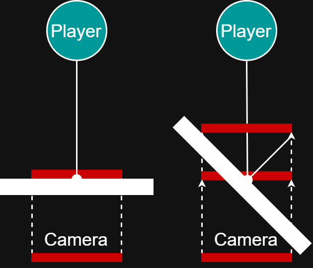

[Home](../../../../index.md) / [Tutorials](../index.md) /

## Overview

The easiest camera controller to make is first-person. A first-person camera is incredibly simple, where it only adjusts the rotation from user input. Third-person cameras, however, are much more complicated, requiring positioning the camera alongside the rotation, and taking care to minimize viewport clipping. Converting to third-person cameras does not break any camera related movement inputs, as the forward and right vectors will point in the same direction as first-person.

## First Person Camera

Here is a very simplistic first-person camera controller, used as the base for this tutorial. The code assumes the new Unity input system is used, with a `Vector2` `Value` property named *“Look”*. Mouse input can be configured with `Delta [Mouse]` keybind. For controller joystick, you usually need to scale the value by `20` in the input system using a preprocessor, alongside a slight deadzone to reduce the effects of joystick drift.

Within the code, you may notice the increment is not multiplied by delta time. This is because mouse delta is framerate dependent. On controller, the inputs are not framerate dependent, however it is not very noticeable between 60fps and 120fps. For robustness, you may multiply by delta time only when a gamepad is connected.

Notice the split between calculating rotation in `Update`, and applying it in `LateUpdate`. `LateUpdate` runs after `Update` for every object, allowing the camera to adapt to external dependencies. For first-person cameras, this may include recoil. For third-person cameras, it is necessary for the player’s position to be fully calculated for accurate positioning.

The layer culling is not necessary for the camera’s function, but it is useful to reduce rendering pressure from far away smaller objects. The array must have a length of `32`, and each field represents the distance, in units, to render for every layer in order.

```csharp
using System.Collections;
using System.Collections.Generic;
using UnityEngine;
using UnityEngine.InputSystem;
 
public class FirstPersonCamera : MonoBehaviour
{
    public PlayerInputs playerControls;
    private InputAction look;

    [SerializeField] private float YMinAngle = -7f;
    [SerializeField] private float YMaxAngle = 80.0f;

    public bool invertx;
    public bool inverty;

    public float xsensitivity = 4.0f;
    public float ysensitivity = 4.0f;

    private float currentX = 0.0f;
    private float currentY = 0.0f;

    [SerializeField] private float[] layerRenderDistances = new float[32];
 
    public bool camMoveAble=true; 

    private void Start(){
        GetComponent<Camera>().layerCullDistances = layerRenderDistances;
    }
    
    private void Awake(){
        playerControls = new PlayerInputs();
    }

    private void OnEnable(){
        look = playerControls.Player.Look;
        look.Enable();
    }

    private void OnDisable(){
        look.Disable();
    }

    void Update(){
        if(!camMoveAble) return;
        Vector2 lookVals = look.ReadValue<Vector2>();
        float currentXIncrement = lookVals.x * xsensitivity;
        float currentYIncrement = lookVals.y * ysensitivity;

        if(invertx)
            currentXIncrement *= -1;
        if(inverty)
            currentYIncrement *= -1;

        currentX += currentXIncrement;
        currentY += currentYIncrement;

        currentY = Mathf.Clamp(currentY, YMinAngle, YMaxAngle);
    }

    void LateUpdate(){
        if(!camMoveAble) return;

        Quaternion rotation = Quaternion.Euler(currentY, currentX, 0);
        transform.rotation = rotation;
    }
}
```

## Third Person Camera

Converting from first to third person requires the following steps:
1.	From the first-person controller’s rotation, move the camera backwards a distance.
2.	Add a target for the camera to look at, for more consistent rotation.
3.	Apply an offset to the target position, to move the player off-centre
4.	Add collision avoidance, by raycasting from the player to the target camera position.
5.	Optional: raycast from the camera to the player, comparing with step 4 to skip narrow objects (such as thin support beams).

### Step 1

Create a vector pointing in the global -Z direction with a magnitude of the desired camera distance, and multiply it with the rotation quaternion from the first-person (in `LateUpdate`). Take this output to directly set the camera’s global position. When updating the position, it is important to apply smoothing with `Vector3.SmoothDamp`, otherwise the camera jitters significantly when following physics objects, and snaps instantly when performing step 4.

```csharp
Quaternion rotation = Quaternion.Euler(currentY, currentX, 0);

float realDistance = defaultCamDistance - distanceOffset;
Vector3 position = rotation * new Vector3(0.0f, 0.0f, -realDistance) + target.position;
transform.position = Vector3.SmoothDamp(transform.position, position, ref positionRef, 0.001f);
```

### Step 2

The second step replaces the camera rotation logic in `LateUpdate` with `transform.Look`. This is recommended, since most good third person cameras rarely look at one static relative position, and `transform.Look` reduces the complexity of calculating the final camera rotation. Adding a target involves referencing an external `transform` (preferably an empty object, placed at the body of the player), and reading its global position.

```csharp
Vector3 Look = target.position;
transform.LookAt(Look);
```

### Step 3

The third step involves adding an offset vector to the target’s position. The offset vector is preferred over using only the position, as it allows for more dynamic camera movements by adjusting the variable in Update, before being applied in the LateUpdate.

Add the public property, so other objects can touch it. Alternatively, add get set functions to a private property.
```csharp
public Vector3 cameraOffset = new Vector3(0,0.3f,0);
```

```csharp
Vector3 Look = target.position + cameraOffset;
transform.LookAt(Look);
```

### Step 4

The fourth step is the most complicated. 

First, an object is detected between the desired camera position, and the target's position using a raycast. Sphere cast is preferred, to move the hit point as close as possible to minimize viewport bleeding. Increasing the radius of the cast directly reduces the amount of viewport bleeding, but makes it much more sensitive to smaller objects. Make use of exclusion layers to minimize this.

```csharp
Vector3 relativeDir = transform.position - (target.position);
RaycastHit hit;
if(Physics.SphereCast(target.position,0.5f, relativeDir, out hit, defaultCamDistance + 0.5f,rayLayerMask)){   

}
```

The required camera offset is then computed, to move the camera in front of the object. For example, if the target distance is 10 units, and an object is detected at 3 units, the offset is 7 (10-3). The offset is then clamped to a minimum value, to prevent the camera moving too close to the player.

```csharp
if(Physics.SphereCast(target.position,0.5f, relativeDir, out hit, defaultCamDistance + 0.5f,rayLayerMask)){   
    offset = defaultCamDistance - hit.distance;
    
    offset = Mathf.Clamp(offset, 0, defaultCamDistance - minDistance);
    distanceOffset = Mathf.SmoothDamp(distanceOffset,offset,ref distanceRef,0.05f);
}
else{
    distanceOffset = 0;
}
```

An additional offset is computed based on the angle between the view direction and the surface normal. If the wall is at an extreme angle, despite the camera moving in front of the object, the viewport will still clip into the edges of the wall (see the illustration). The solution given in the code is only a small approximation, and will result in some minor clipping. A more robust method is to block additional camera movement at steep angles, and use the camera's viewport to shift forward until there is no overlap.




```csharp
if(Physics.SphereCast(target.position,0.5f, relativeDir, out hit, defaultCamDistance + 0.5f,rayLayerMask)){   
    float angle = Vector3.Angle(relativeDir, hit.normal);
    offset = defaultCamDistance - hit.distance;
    
    if(angle < 100){
        offset += (1 - angle/100) * 2f;
    }
    
    offset = Mathf.Clamp(offset, 0, defaultCamDistance - minDistance);
    distanceOffset = Mathf.SmoothDamp(distanceOffset,offset,ref distanceRef,0.05f);
}
else{
    distanceOffset = 0;
}
```

### Full Code

Combining the four steps gives the full, simplified, third person camera controller:

```csharp
using System.Collections;
using System.Collections.Generic;
using UnityEngine;
using UnityEngine.InputSystem;
 
public class ThirdPersonCamera : MonoBehaviour
{
    public PlayerInputs playerControls;
    private InputAction look;

    [SerializeField] private float YMinAngle = -7f;
    [SerializeField] private float YMaxAngle = 80.0f;

    public bool invertx;
    public bool inverty;

    public float xsensitivity = 4.0f;
    public float ysensitivity = 4.0f;

    private float currentX = 0.0f;
    private float currentY = 0.0f;

    [SerializeField] private float[] layerRenderDistances = new float[32];
 
    public bool camMoveAble=true; 

    private float distanceOffset;
    private float offset;
    public Vector3 cameraOffset = new Vector3(0,0.3f,0);
    public float defaultCamDistance = 10.0f;
    public float minDistance = 2;

    [SerializeField] private Transform target;

    [SerializeField] private LayerMask rayLayerMask; 

    private float distanceRef = 0.0f;
    private Vector3 positionRef = Vector3.zero;

    void Start(){
        GetComponent<Camera>().layerCullDistances = layerRenderDistances;
    }
    
    private void Awake(){
        playerControls = new PlayerInputs();
    }

    private void OnEnable(){
        look = playerControls.Player.Look;
        look.Enable();
    }

    private void OnDisable(){
        look.Disable();
    }

    void Update(){

        if(!camMoveAble) return;

        Vector2 lookVals = look.ReadValue<Vector2>();
        float currentXIncrement = lookVals.x * xsensitivity;
        float currentYIncrement = lookVals.y * ysensitivity;
        if(invertx)
            currentXIncrement *= -1;
        if(inverty)
            currentYIncrement *= -1;
        currentX += currentXIncrement;
        currentY += currentYIncrement;
        currentY = Mathf.Clamp(currentY, YMinAngle, YMaxAngle);
        

        Vector3 relativeDir = transform.position - (target.position);
        RaycastHit hit;
        if(Physics.SphereCast(target.position,0.5f, relativeDir, out hit, defaultCamDistance + 0.5f,rayLayerMask)){   
            float angle = Vector3.Angle(relativeDir, hit.normal);
            offset = defaultCamDistance - hit.distance;
           
            if(angle < 100){
                offset += (1 - angle/100) * 2f;
            }
            
            offset = Mathf.Clamp(offset, 0, defaultCamDistance - minDistance);
            distanceOffset = Mathf.SmoothDamp(distanceOffset,offset,ref distanceRef,0.05f);
        }
        else{
            distanceOffset = 0;
        }
    }

    void LateUpdate(){
        if(!camMoveAble){return;}
        
        Quaternion rotation = Quaternion.Euler(currentY, currentX, 0);
        float realDistance = defaultCamDistance - distanceOffset;
        Vector3 position = rotation * new Vector3(0.0f, 0.0f, -realDistance) + target.position;
        transform.position = Vector3.SmoothDamp(transform.position, position, ref positionRef, 0.001f);

        Vector3 Look = target.position + cameraOffset;
        transform.LookAt(Look);
    }
}
```

