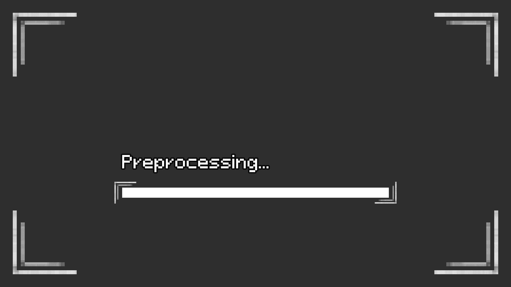

[Home](../../../../index.md) / [Tutorials](../index.md) /

## Overview

Changing scenes is extremely common. However, the default change scene method freezes the game for a variable amount of time. The user does not know if this freeze is the game crashing, or is simply loading. The purpose of a loading screen is to convey to the user that the application is running correctly between large load operations. Loading screens often require two phases: the scene loading and transition stage, and performing Start and Awake in the new scene.

## Swapping Scenes

Instead of using `SceneManager.LoadScene(int)`, which pauses the game until completion, use `SceneManager.LoadSceneAsync(int)`. The async operation does not block on the main thread, allowing frames to progress. The function returns an `AsyncOperation`, which exposes the progress attribute that can directly drive a progress bar, by changing an image’s fill amount.

The loading screen should be placed in a dedicated scene, allowing the previous scene to unload, and increase maintainability. The scene should be minimal, so that swapping to it is almost instant. Since swapping scenes needs a loading screen, but the loading screen is also in another scene, this transition must instead be hidden, commonly using a fade to black. Signalling the target scene can be done using either a static integer, or a persistent object. A static integer is preferred, as a persistent object can cause runtime bugs when used improperly, especially if the object is duplicated.

This following script contains the code for a loading screen. This can be placed on any object on the dedicated scene, containing at least one Image for the progress bar.

```csharp
using System.Collections;
using System.Collections.Generic;
using UnityEngine;
using UnityEngine.SceneManagement;
using UnityEngine.UI;
using System;

public class LoadScreen : MonoBehaviour
{
    public static int scene = 2; // intialize the default scene. Do not set to the same as a scene with this script, as it causes an endless loop
    [SerializeField] private Image progressBar;


    void Start(){
        StartCoroutine(LoadAsyncOperation());
    }

    public IEnumerator LoadAsyncOperation(){
        yield return Resources.UnloadUnusedAssets();
        GC.Collect();
        yield return null;

        AsyncOperation gameLevel = SceneManager.LoadSceneAsync(scene);
        gameLevel.allowSceneActivation = false;

        float targetProgress = 0;
        float displayedProgress = 0;

        while(!gameLevel.isDone){
            
            targetProgress = Mathf.Clamp01(gameLevel.progress / 0.9f);
            displayedProgress = Mathf.MoveTowards(displayedProgress, targetProgress, Time.deltaTime);
            
            progressBar.fillAmount = displayedProgress;

            if (gameLevel.progress >= 0.9f && displayedProgress >= 0.99f){
                // optional pause, so the user has time to process the bar completely filling, and to buffer instant loads.
                yield return new WaitForSeconds(0.5f);
                gameLevel.allowSceneActivation = true;
            }

            yield return null;
        }
    }
}
```

Replace all instances of load scene with this function, and place the scene at either index 1 or 2 (after the menu and any bootstrap scenes):

```csharp
public static void ChangeScene(int sceneNum){
    LoadScreen.scene = sceneNum;
    
    const int loadingScreenSceneNum = 1;
    SceneManager.LoadScene(loadingScreenSceneNum);
}
```

Notice the manual garbage collector call. The garbage collector can commonly cause large frame time spikes, especially after unloading a scene. So, forcing this to occur in the loading screen, where the user already expects lag spikes, is the best possible time. While usually bad practice, this is an exception.

The `allowSceneActivation` flag is used to prevent the scene from automatically switching. This allows the progress bar to fully complete, and perform any additional operations before loading.

The `targetProgress` variable is divided by `0.9` to allow the progress bar to visually fully complete. The last 10% of scene loading is fast, so directly using the progress would appear as though the progress bar never fills. Completely filling the bar at 90% is purely an aesthetic change, and can be omitted.

To add loading screen tips, store all tips in a JSON file, loaded on start. Randomly pick a string from a list, and cycle over time. Put the loading screen tips into a separate coroutine. Tips should only be implemented in long loading screens, where it takes longer than 10 seconds.

## Starting a Scene

`LoadSceneAsync` does not run start. So, in scenes with an expensive start method, such as procedural generation, the game will stall when entering the scene. For expensive start methods, offload the logic into a coroutine, allowing the scene to progress through frames. Without this, a loading screen is impossible, as `Start` cannot be run async.

The second loading screen must be fully driven by your code. You must manually set milestones representing the loading progress. As such, this section will not contain sample code. This is an example loading screen for procedural dungeon generation, with custom set milestones for each section of generation:



## Visuals

The overall design of a loading screen has little impact, as long as it matches the game's style. However, it is extremely important to include at least one constantly animating component. Something as simple as a spinning half-circle is sufficient. The purpose of a loading screen is to convey what the game is doing in the background, and that the game has not crashed. Excluding an animated component breaks this principle, since the loading bar only changes in chunks. Progress can commonly stall for prolonged periods, which the user can mistake as a crash.

Here are some types of dynamic elements to detect stalls on the main thread, to help adapt the loading screen to your art style:
-	Make the background an animation or panorama, that is constantly moving.
-	Add an animated icon/gif, such as a player running animation, or a spinner. This is the common approach.
-	Add visual effects to the loading bar, such as sparks, pulsing, or colour changing.
-	Add visual effects to the background, such as dust.
-	Animate a portion of any displayed text, such as a wave pattern in “…” text.
-	Add a timer or clock.

It is common to have two different loading screen styles: one for the first load, and another for basic loading between scenes. The first load before/after the menu usually has higher detail, and are more likely to use animated backgrounds. The other loading screens reduce the detail for faster loading, and instead opt for a basic spinner as the dynamic element. 

The first load is significantly longer than the rest, where it must: compile shaders, create caches, load save data, create object pools, connect to online services, and more. This long wait is the user’s first experience, which is extremely important to get right for player retention. A non-flamboyant first loading screen significantly increases the likelihood that the user will immediately quit the game after loading the main menu, never reaching the actual content. For most indie games, two different loading screens are unnecessary, due to lower load times and the user’s expectations.
