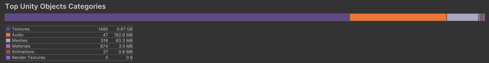
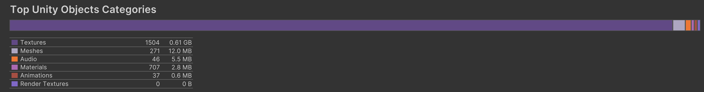

[Home](../../../../index.md) / [Tutorials](../index.md) /

## Overview
Unity’s `AudioSource` component is crucial for adding sound effects and music to a project. The component has a wide variety of tools allowing for a range of techniques to spread audio assets further.

## AudioSource Properties
The `AudioSource` has the following important properties to configure:
-	Priority: Unity has a maximum number of `AudioSources` that can play at once, set via project settings. Sources with a lower value are higher priority. Unity is more likely to play sources with the lowest value, and uses volume as a tie breaker (louder sources are prioritized). Priority does not matter for WebGL builds.
-	Volume: determines the playback sound of the source. While it maximises at 1 in the editor, `PlayOneShot` can use a higher volume, but take care to avoid clipping.
-	Pitch: changes the frequency of the audio clip. It does not adjust for the change in wavelength, and so speeds up or slows the output.
-	Spatial Blend: determines how much of the output volume is dependent on the distance to the `AudioListener` in the scene. This spatial audio is dependent on the source’s 3D sound settings.

## Standardised Audio Volume

It is extremely important for maintainability to tie the volume of all sounds to a standardized float variable, to remove massive headaches when attempting to add a volume settings slider later. 

While it is generally bad practice, the best way to standardize the volume is through a static variable inside a `SettingsData` or `Variables` static class. An instanced class for volume control can be used instead, but this requires deep coupling to every class using audio. A static variable has the benefits of: working across scenes, so only needs to be changed once; instantiated objects do not require adding a reference during creation; and simplifying logic. The deep coupling between all objects using an AudioSource cannot be avoided, so the static variable is the least intrusive.
To use the static variable, just multiply the original volume float with the static variable:

```csharp
source.PlayOneShot(clip, volume * SettingsData.sfxVolume);
```

## Changing Background Music

Background music is the most effective part of sound design to set the atmosphere. As such, swapping between different background tracks is essential.

### Fading Between Songs

If the two audio tracks are vastly different and cannot be effectively mixed, the best method is to fade out the current track, and fade in the next. This is the method I used in my game Rebirth of the Forsaken. Alternatively, crossfading can be used for a more seamless transition, using two audio sources fading in and out at the same time.

```csharp
public AudioSource audiosource;

[System.Serializable]
public class soundEffect{
    public string soundName;
    public AudioClip soundClip;
    public float volumeMultiplyer = 1;
}
public soundEffect[] sounds;

public void ChangeSound(string soundname){
    lastSound = soundname;
    if(locked){return;}
    for(int i=0;i<sounds.Length;i++){
        if(sounds[i].soundName==soundname){
            StartCoroutine(StartFade(i,1f,0));
            return;
        }
    }
}

public void ResetSong(){
    for(int i=0;i<sounds.Length;i++){
        if(locked){
            if(sounds[i].soundName == lockedSound){
                StartCoroutine(StartFade(i,1f,0));
                return;
            }
        }
        else{
            if(sounds[i].soundName==lastSound){
                StartCoroutine(StartFade(i,1f,0));
                return;
            }
        }
    }
}

public IEnumerator StartFade(int arrayNumber, float duration, float targetVolume){
    float currentTime = 0;
    float startVolume = audiosource.volume;
    float targetVolume2 = SettingsData.musicVolume * sounds[arrayNumber].volumeMultiplyer;
    while(currentTime < duration){
        currentTime += Time.deltaTime;
        audiosource.volume = Mathf.Lerp(startVolume, targetVolume, currentTime / duration);
        yield return null;
    }
    audiosource.Stop();
    audiosource.clip = sounds[arrayNumber].soundClip;
    audiosource.PlayScheduled(2f);
    yield return new WaitForSeconds(0.2f);
    currentTime = 0;
    startVolume = 0;
    while(currentTime < duration){
        currentTime += Time.deltaTime;
        audiosource.volume = Mathf.Lerp(startVolume, targetVolume2, currentTime / duration);
        yield return null;
    }
}

```

### Changing to an Alternate Track

Another technique is to create multiple variations of the same music track, each with different vibes. This technique is most commonly used in area battle themes, where it is usually the area theme with additional instruments.
To swap between these variations, assuming the `AudioSource` is playing on loop, change the `AudioClip` while preserving the same playback time and call `Play()`.

```csharp
float t = source.time;
source.clip = alternateClip
source.time = t;
source.Play();
```

## Audio Variation with Pitch Shifting

Instead of creating dozens of variations of the same sound, it is possible to instead create only 2-4, and apply a pitch shift to add more variation. It is poor sound design if the player can very easily tell it is the same sound effect played repeatedly, especially if the time between sounds is small (such as hit sound effects on multi-hit attacks). Unity allows the pitch to be adjusted directly in script.

Unity’s `AudioSource`, however, has the limitation that the playback speed and the pitch are coupled. Decreasing the pitch makes the sound last longer. So, for small clips, it is best to keep it within 0.9-1.1. This gives enough variation, without a noticeable change in clip length. Pitch shifting without the speed increase can be done as an effect in an `AudioMixer`. However, this adjusts all connected sources.

```csharp
public void PlayClipVariation(AudioSource source, float minPitch, float maxPitch){
    source.pitch = Random.Range(minPitch,maxPitch);
    source.PlayOneShot(hitSFX,volume * SettingsData.volume);
}
```

## AudioMixer

Mixer groups allow real-time audio processing, including effects like reverb, filtering, echo and more. The main benefit to an audio mixer is to apply context specific effects, such as being underwater. Changes to one mixer effect every source using it, reducing complexity for large scenes with many sources, but limiting single source capabilities.

A mixer can be assigned directly to the `AudioSource` component, where the effect values can be adjusted within scripts, or swapped entirely. Adjusting the mixer’s values does not permanently alter the asset, and is undone when exiting play mode. Swapping the mixer group, however, is the better option as it allows fine tuning specific parameters to swap out when needed.

```csharp
public void ChangeMixerGroup(AudioSource source, AudioMixerGroup group){
    source.outputAudioMixerGroup = group;
}
```

Instead of swapping the group, which is an abrupt change, a smoother alternative is to use mixer snapshots using `TransitionTo`. Mixer snapshots allow blending between mixer group settings, best used for zone specific settings. Unity’s own official tutorial gives the best explanation for how to use snapshots: (https://www.youtube.com/watch?v=2nYyws0qJOM). Snapshots can be used instead of the manually fading for background music transitions, allowing more control. This, however, forces the use of two audio sources playing concurrently, significantly increasing runtime memory usage.

## Performance

The performance of audio has very little to do with 3D spatial effects, or mixer groups. Instead, the most significant performance challenge is memory. The memory usage depends entirely on the import settings for the audio clip, specifically the load type and Vorbis compression quality:
-	Decompress on Load: on start, it loads the audio into memory for minimal performance overhead when playing the sound. This should be used for small clips.
-	Compressed in Memory: decompress audio clips when playing, but leave compressed in memory. It uses less memory than decompress on load, at the cost of higher overhead when decompressing the audio.
-	Streaming: reads the audio from disk continuously, using almost no RAM. This is best used for background music.
With many different background audio tracks, it is very important to set it to streaming. As an example, memory profile of my game Rebirth of the Forsaken, with decompress on load, and with streaming for the background music.

### Memory Profile with Decompress on Load

From the profile, the audio takes up almost 200MB of RAM at all times. Since only one of dozen music tracks are playing at once, most of this memory is wasted.




### Memory Profile with Streaming

Setting the load option to streaming reduced the memory load by 40x to only 5.5MB, which is a significant reduction. This significant improvement came at the cost of a very minor framerate reduction due to disk operations; however, the reduced memory improves the user experience significantly more, by supporting a wider range of devices. Streaming is mandatory for mobile games, due to the low memory constraint.

