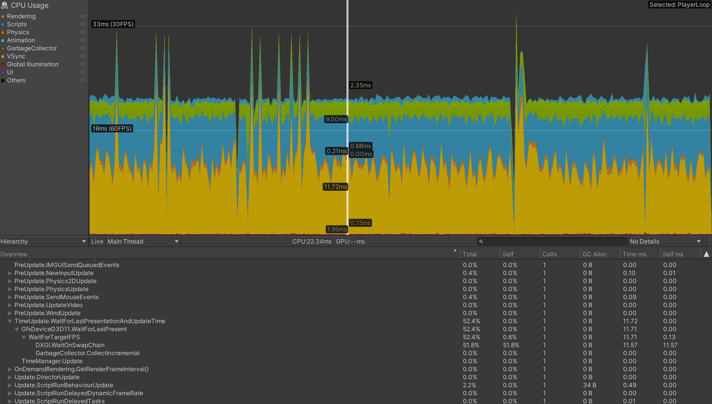

[Home](../../../../index.md) / [Tutorials](../index.md) /

## Overview

Pareto principle states 80% of the performance issues are caused by 20% of the codebase. This 20% must be identified via profiling, to reduce wasted effort. In Unity, many developers make the mistake of attempting micro-optimisations in their custom scripts. However, these represent less than 5% of work per frame, wasting effort. Focused optimisation can make reaching performance milestones much easier.

## Steps to Optimising a Program

1.	**Profile** to determine components with the highest potential gains.
2.	Create **optimisation targets**.
3.	**Plan** a method of optimisation, and gradually **implement** it.
4.	**Test** the changes, to not introduce new bugs.
5.	Repeat from step 1.

## Profiling

Profiling a game can be done in the editor with the Profiler (window->analysis->profiler). The profiler can sample CPU, GPU, memory, IO, audio, and more, with detailed call stack information. It can be used for both the editor and a dev build. The dev build is preferred, as the editor introduces additional overhead. The downside to the dev build is it also requires the editor to be open, using significant RAM.

To create a development build, in the build menu enable *Development Build*, *Autoconnect Profiler*, and *Deep Profiling Support*. With autoconnect enabled, the build will transmit profiling information over a localhost IP server address. To read the results, keep the profiler open in the editor and change the source (next to the record button) to the local server. Follow the official Unity tutorial for additional [details](https://docs.unity3d.com/2022.3/Documentation/Manual/profiler-profiling-applications.html).

## Analysing the Profile

The profile displays a lot of information, that is hard to determine what has value. The important information is displayed when inspecting a single frame, inspecting the hierarchy menu, and not from the graphs. Graphs are only useful for finding lag spikes.

Lag spikes are not gauranteed to be caused by your optimisation. Using a dev build, some TCP packets can be dropped or corrupted. External factors also cause issues, such as the process being paused by the operating system. An unusual lag spike can be detected by analysing the frame, where the displayed total time may be large (eg 3000ms), but the sum of all individual components seen from the hierarchy display sums to a standard value (eg 16ms).

### Traces safe to Ignore

For CPU performance, vsync can be ignored. It simply forces a target framerate from introducing idle time. With vsync disabled, the CPU trace is replaced with the wait time to maintain the target framerate, under the same name. “Others” can also be ignored, as it includes delays outside of your control, such as profiling overhead.

### Threads

The profile contains information on all threads. The total frame time is always bound by the longest thread, which is usually the main thread. Therefore, inspection into other threads is often unnecessary. However, it is important to consider when manually parallelising logic.

### Example Profile

From this profile sample, vsync is approximately half of the frame time, demonstrated from the WaitForTargetFPS process. So, while the runtime framerate is 45 fps, the current level of optimisation allows for a maximum of 90-100. The maximum possible framerate is bounded by 1000 divided by the frame time. For example, assume a pathfinding algorithm takes 1ms, the maximum possible framerate with this script is 1000 fps. Unity’s processes bind the framerate to at most 400 fps, which can be tested from profiling an empty scene. Breaks in the timeline are lost TCP packets.

### Example Analysis

From a selected stable frame, the ranking of the top detractors to performance for the main thread are displayed in the following table. This ranking is specific to Rebirth of the Forsaken, in the main level. The scene averages 1500 draw calls, contains over 50 000 objects, 700 materials, and at least 50 unique scripts containing Update active at any given moment. The benchmark is performed without a GPU, vsync disabled and targeting 60 fps, on an Intel® Core™ Ultra 7 155H CPU.

| Process | Actions | Contribution (%) |
|----------|----------|------------------|
| WaitForTargetFPS | Vsync / target framerate wait | 56 |
| UniversalRenderPipeline.Render | (FinishFrameRendering) 23% from rendering a single camera, with the most taxing operations being Execute() and Cull(). Execute is dependent mainly on draw calls, and Cull is dependent on the occlusion culling, impacted by the number of renderers. | 26.3 |
| PlayerUpdateCanvases | Rendering canvas elements, mostly in mesh generation in the pre render. | 5 |
| PhysicsFixedUpdate | Manages rigidbodies. The main performance cost is in simulating the body (1.8%) and syncing colliders (0.5%). | 2.8 |
| Update.ScriptRunBehaviourUpdate | Custom scripts, specifically from the Update() function. The most taxing component is reading the input (0.5%). Also contains EventSystem, Debugger, and Volume (post processing). | 2.2 |
| ParticleSystem.Update | Handles particle system collision, trails, and rendering. | 1.1 |

Ignoring vsysnc, rendering to the camera dominates runtime, mainly from draw calls and culling. Shadows and lighting are negligible comparatively. So, reducing draw calls from 1500 to 1000 and lowering the number of active renderers (reducing the pressure on culling) would produce significant gains. Draw calls can be reduced using GPU instancing, reducing the number of unique materials, combining meshes, and simplifying the environmental design. The number of renderers can be reduced by disabling far objects, and using additive scene loading. 

Once this is exhausted, the canvas would be optimised by reducing the number of elements. This is done by combining static UI elements into a sprite and limiting masking. Physics, custom scripts, and particle systems are not worth pursuing.

However, since the game achieves a consistent 60 fps on a laptop in a large scene with no GPU, with spare time from vsync, it is reasonably well optimised. In this context, optimisation will simply increase the idle time (vsync), and is not actually worth pursuing.

## When Optimisation is Worth Pursuing

Before wasting a considerable effort improving performance, it is worth analysing if optimisation is necessary. It is beneficial if it enables one of the following:

-	Increase fps threshold to a higher level, improving user experience. For example, 30 to 60 fps.
-	Allow the game to run on weaker hardware, such as porting to mobile.
-	Increase framerate consistency, such as reducing frame drops and periodic lag spikes.
- Reduce input lag. This is mainly necessary for competitive multiplayer games.

If your game reaches an acceptable framerate consistently (such as 60) on the target hardware, with no noticeable drops, it is generally not worth optimising. But, always compare the performance with similar games on the market. While it may be sufficiently well optimised, if it is worse than the alternatives, players are less likely to choose your game.

Memory optimisation is similar. It is only worthwhile if it enables faster load times, reduced garbage collector spikes, and minimising out-of-memory crashes. Lower memory usage is always better for a power usage perspective, especially for handheld devices, but is not mandatory for a good experience like with frame rate. Only optimise memory if usage is unusually high, or the target device has low RAM.

## Multithreading

Computationally expensive algorithms can be multithreaded to spread work from the main thread. However, almost all unity API calls must be run on the main thread, so multithreading has limited applications. Only pure C# code can be multithreaded, but Unity structs, such as `Vector3`, can be used. The best application for multithreading is enemy pathfinding, where A* can be relatively expensive to compute when run repeatedly on multiple enemies. Multithreading is not recommended, as it can cause hard to trace bugs, reduce performance, and cause memory leaks. Synchronisation is also difficult to perform correctly, without hindering the game’s performance. Multithreading is an advanced topic that should be performed by an expert.

Multithreading is also entirely dependent on the CPU architecture. Some older CPUs may only have 4 cores, in which manually multithreading will hardly distribute work at all, and only increase CPU scheduling overhead. Analyse the average CPU of the target audience to determine if multithreading is beneficial.

## CPU Optimisations

This section highlights methods to optimise the most computationally taxing components, analysed by the profile.

**URP Rendering**
- Excecute()
  - Reduce draw calls through mesh combining, reducing material variants, lowering scene detail, or static batching.
  - Use GPU instancing for repeated meshes.
  - Merge render passes (such as different post-processing effects) into one full-screen pass.
  - Reduce the number of cameras. Every additional camera performs render passes.
  - Reduce transparency. Transparent objects should also not cast shadows.
  - Reduce shadow casters and shadow quality.
  - Reduce real-time lighting. Use baked lighting instead, at the cost of higher memory usage.
  - Optimise mesh UVs to avoid overlapping. Overlapping UVs increase strain on lighting calculations.
- Cull()
  - Reduce renderer count by combining meshes, or manually disabling large portions of the scene that cannot be visible (such as when entering a building).
  - Reduce shadow distance. This lowers the amount of potential shadow renderers to cull.
  - Reduce dynamic objects. Ensure all scene geometry is marked static.
  - Split large objects. This counters mesh combining, but it allows parts of a mesh outside the camera to be culled, improving culling efficiency.
  - Optimise mesh topology, minimising triangle count. This does not impact performance as significantly as having more renderers, so do not sacrifice mesh quality for minor gains.

**Canvas rendering**
- Canvas rendering partially contributes to the URP rendering cost, so many of the same principles apply here.
- Disable raycast and mask target on as many elements as possible.
- Combine layered UI elements into a texture. For example, when a sprite is used as a border to a pannel.
- Minimise parenting. Each parent must propagate its anchors to the children, adding unnecessary overhead.
- Minimise usage of Text or TextMeshPro components. If the components are static, such as headings, consider converting to a texture for a release branch. Keep the text during development, for better maintainability.

**Physics FixedUpdate**
- Increase the fixed timestep in the project settings (under Time). This directly reduces the amount of work, at the cost of simulation accuracy.
- Reduce active rigid body counts. If a body is far from the camera, or does not need to simulate, disable it. Set stationary bodies to isKinematic. Rigidbodies are automatically set to sleep, so avoid setting velocity to zero repeatedly in Update.
- Simplify colliders. Use only primitive collision types (cube, sphere, capsule), and avoid MeshCollider. A common misconception is that a convex MeshCollider is better performing than a standard MeshCollider due to lower vertices, but calculating the convex mesh actually adds additional overhead.
- Configure the layer collision matrix in project settings to minimise collisions. This can alternatively be done on individual colliders, but the project settings are more maintainable.
- Reduce physics quality using the project settings:
  - Disable auto sync transforms. It should already default to off.
  - Lower the default solver iterations.
  - Lower the sleep threshold.

## Memory Optimisations

When profiling memory, outside of minimising dynamic allocations inside of scripts, 90% of gains are from optimising textures and audio.

**Textures**
- Optimise texture dimensions. 
  - Textures that can be evenly tiled in power of 2 blocks (for example, 4x4, 8x8, 16x16, etc) do not require padding, and can perform graphics calculations more efficiently. This generally requires both dimensions to be power of 2, but does not have to be a square. Avoid this if the nearest power of 2 far, as the memory increase is too detrimental. For example, a dimension of 3100 is too far from 2048.
  - Avoid odd dimensions. A 256x256 texture is significantly better than a 256x257 texture. 
  - Usage of non-power of 2 dimensions depends entirely on the compression format. Research the compression types to determine the most optimal for your texture. For example, some formats can only compress square textures.
- Reduce texture sizes. A 512x512 texture is a quarter the size of a 1024x1024 texture, for only half a reduction in quality. Single colour and pixel art textures can be a much lower size without a noticeable drop in quality.
- Strip the alpha channel from textures without transparency. Remove the alpha source or set the compression format to RGB in the import settings.

**Audio**
- Set large audio files (>30MB) to streaming type.
- Set moderate size, but infrequently used audio to *Compressed in Memory*.
- Set small commonly used audio (such as sound effects) to *Decompress on Load*.
- Enable force to mono, effectively halving memory cost by removing a channel. This may significantly reduce audio quality, so it is best to include this as an in-game setting.
- Reduce the quality in the import settings. Reduce mainly for *Compressed in Memory* audio clips.
- Reduce the sampling rate. Use this as a last resort, as it can significantly degrade audio quality and cause some auditory bugs.

## Good Scripting Practices

While custom scripts have an almost negligible performance cost, good programming practices can reduce CPU and memory pressure without the need for extensive code rewrites, making your game much more maintainable. Good practices for optimal code often conflict with general coding practices, such as minimising global variables. The trade-off between good performance and good code should be considered.
-	In `Update`, `LateUpdate`, and `FixedUpdate`:
  - Avoid memory allocations (such as new())
    - Objects created every frame, such as int[] arr = new(), can be pre-allocated in a private global variable. 
    - Avoid string concatenations. If needed, use StringBuilder instead.
    - Avoid `ToString`, `ToList`, and `ToArray`, as these create new objects.
    - Use structs over classes for data containers, lowering dynamic memory allocation. Note that structs are copied by value, not reference. Consider struct packing, putting the largest properties higher (for example, Vector3 above integers, above bytes, and above Booleans), to minimise the size of the struct.
    - Consider using Enum values over string literals.
  - Avoid expensive unity functions, and instead cache the result on awake:
    - `GameObject.GetComponent<T>`.
    - `GameObject.Find`.
    - `Camera.Main` – expensive on older versions, but is still better cached.
    - `Instantiate` and `Destroy` – use object pooling instead.
    - LINQ.
    - Reflection.
    - `transform.SetParent` – fine to use, just don’t change constantly, as hierarchy updates are expensive.
  - Avoid directly changing physics objects. Only use `AddForce`, and avoid directly setting velocity and acceleration.
- In coroutines, instead of repeated `yield return new WaitForEndOfFrame()` (or equivalent object), create in once in a local variable, and return that instead.
- For comparing object tags (commonly in triggers), use `CompareTag` instead of `gameObject.tag == “your_tag”`.
- Return as early as possible with guard clauses, avoiding unnecessary work.
- With a large number of scripts running update, consider renaming update and calling it from a manager. For example, a manager script calls an equivalent to Update to 50 different objects every frame. This reduces script overhead, but only with a large number of scripts.
- Remove MonoBehaviour from classes that do not require any built-in functions (`Update`, `Awake`, `OnTriggerEnter` etc). This slightly improves memory usage and load times by decoupling from GameObject, Transform, and scene registration.
- Add a `LayerMask` to colliders and raycasts. While the collider’s mask is set outside the script, exclude layers reduce invocations of the collision functions. For raycasts, masks reduce the number of eligible colliders, increasing performance.
- For timers, using `Update` to change a local variable by `Time.deltaTime` is better performing than Invoke or Coroutines. Coroutines should be used if there are multiple sequential waits to reduce code complexity. Invoke has no use case outside of code readability, due to the string lookup. Coroutines and Invoke have similar performance overhead.

## Conclusion

In Unity, the CPU performance is almost always dominated by rendering, and memory is dominated by textures and audio. Optimising custom scripts is mostly useless, giving marginal gains at best. The profiler is an important tool to determine which specific components are the bottleneck, allowing more focused optimisation.

Generally, performance is best improved by reducing the number of renderers and draw calls. Reducing model, lighting, shadow, and texture quality is almost never worth the sacrifice to visual quality, unless bound by RAM.
