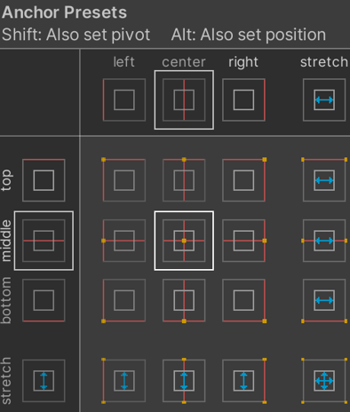
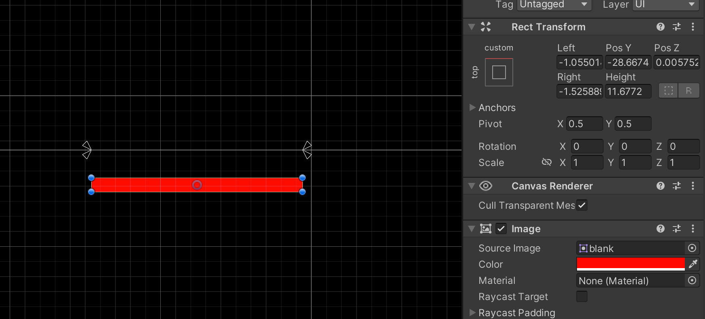
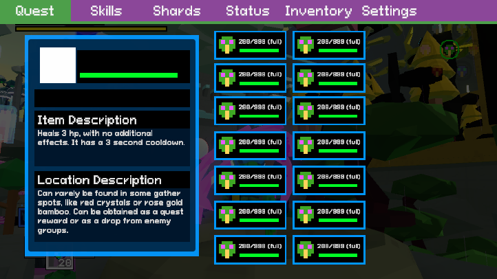
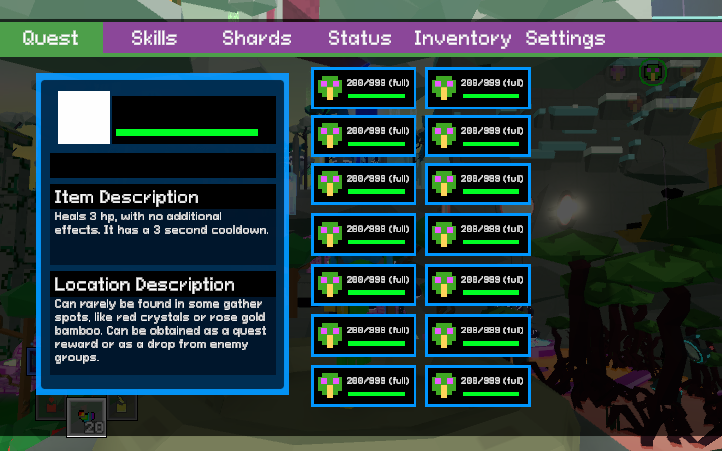
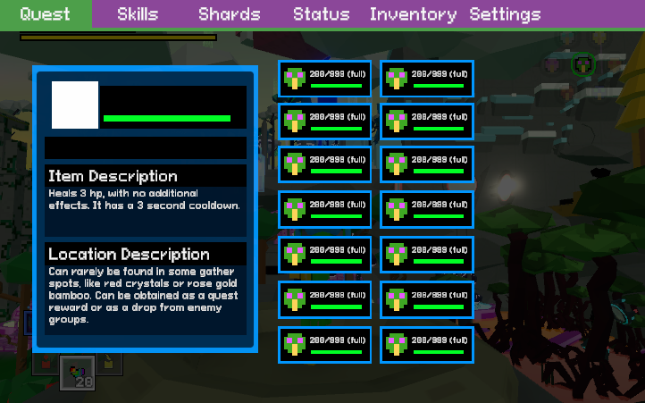
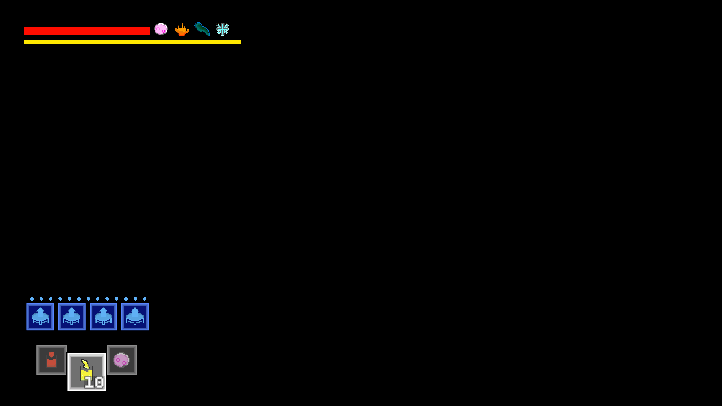
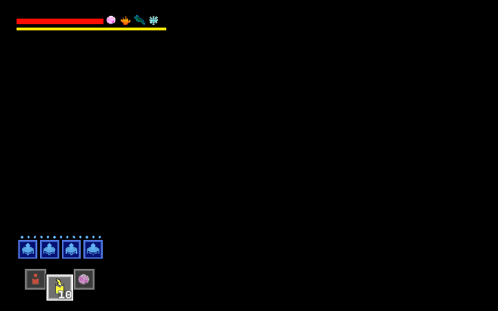
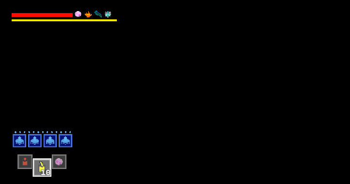
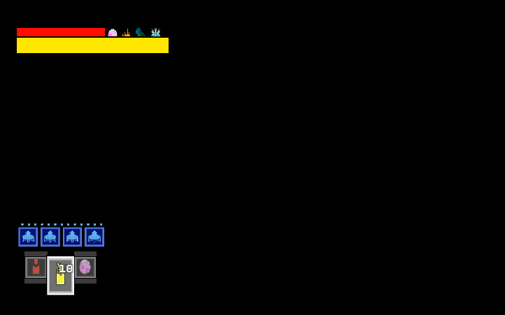
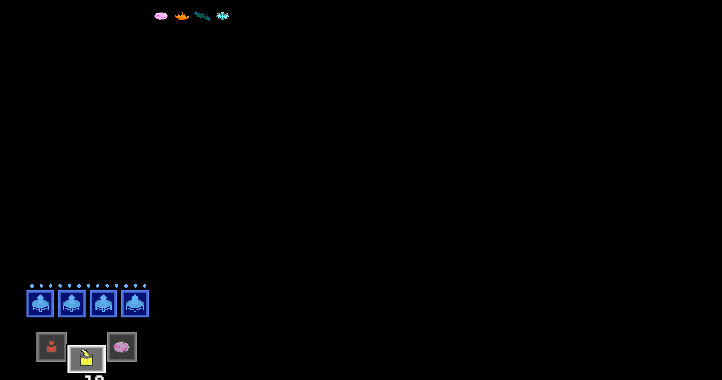

[Home](../../../../index.md) / [Tutorials](../index.md) /

## Overview

The most challenging aspect of creating a user interface is to support multiple aspect ratios. You may create a well-developed UI in 16:9, but when switching to 16:10, full-screen panels are no longer full-screen. Or, when switching from 16:10 to 16:9, some elements compress vertically and overlap. This drastically decreases the quality of the game, hurting the user experience. This can be prevented by correctly setting anchors.

## Anchors

Anchors determine how UI elements respond when the bounds change. Unity has two types of anchors: positional, and stretch anchors. Positional anchors place the UI component to the relative position in the bounds. For example, middle left will move the element left when the width increases, but keeps the same height when the height increases. Stretch anchors scale the component across an axis. For example, black bars for cutscenes would be set to top/bottom horizontal stretch, and so will always fill the screen.

Anchors and bounds are shown graphically in the editor. The bounds are the white rectangle on the canvas when the element is selected, and the anchor is the clover shaped symbol, split into four quadrants. Custom anchors can be made by moving each corner of the anchor gizmo. It acts positional when the quadrants are together, and stretch when apart. The position and scale are relative to the bounds, which is inherited from the parent. So, set the anchor based on the reference aspect ratio. Custom anchors can be used to balance between positional and stretch anchors. For example, a custom anchor can be used to ensure a component stretches across only 30% of the screen, such as a boss health bar. This configuration is demonstrated in the image:

Use positional anchors for UI elements with a fixed size, such as health and stamina bars. Use stretch anchors for full-screen menu UIs and panels, that must fill the screen regardless of the aspect ratio.

## Parenting

The biggest cause of anchors seemingly not working is parenting. A child’s anchor is relative to the parent. However, it does not inherit grandparents. For example, with this hierarchy:
- Entire menu folder – centre anchor
  - Inventory folder – stretch anchor
    - Title – top centre anchor
    - Inventory panel – middle horizontal stretch anchor

You may expect the title to move up if the screen height increases, and the panel to distribute horizontally when increasing the width. However, since the menu folder’s anchor does not stretch, the inventory folder’s bounds do not change. This prevents the subfolder from expanding, and so its children never move. See the following images for an example, where all anchors are set correctly, except for the parent, causing issues when increasing the height. The first image is the default aspect ratio (16:9), the second has the wrong parent anchor, and the third is with the correct anchor (16:10).

  
  
  

Empty objects, used mainly for organisation, should always have their anchors set to stretch. This gives all children the same bounds as the grandparent, allowing more consistent anchoring. If a parent has positional anchors, the child’s anchors almost never matter due to fixed bounds.

Grouping elements under a shared parent with a positional anchor does have an important use case, however. With a large density of UI elements, grouping ensures all elements maintain the same distance between each other regardless of the aspect ratio. Without grouping, the variation in position may cause some elements to overlap.

To demonstrate the effect of grouping, observe the differences in the following sample with 16:9, 16:10, and 19:10 aspect ratios, where all children are set to stretch anchors. Stretch is not the correct anchor for this configuration, but is used to best showcases the changes. The scene has two component groups, in the top and bottom left of the screen. The top left group contains the health and stamina bar, and the  In this example, setting the parent to a positional anchor is the desired option, as stretch causes distortion.

**Parent anchor set to bottom/top left:**

  
  
  

**Parent anchor set to stretch:**

  
  
  

